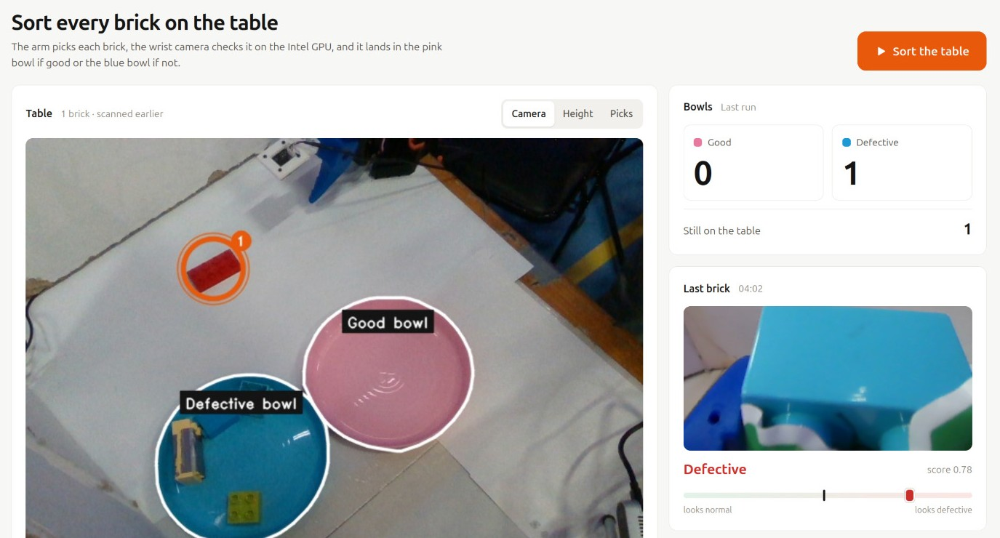
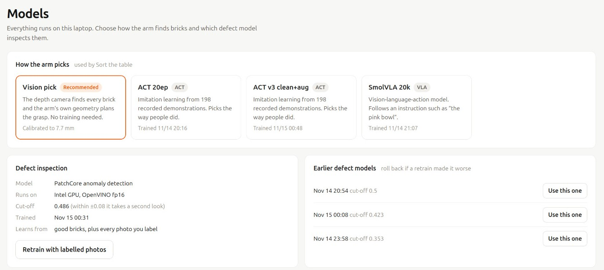
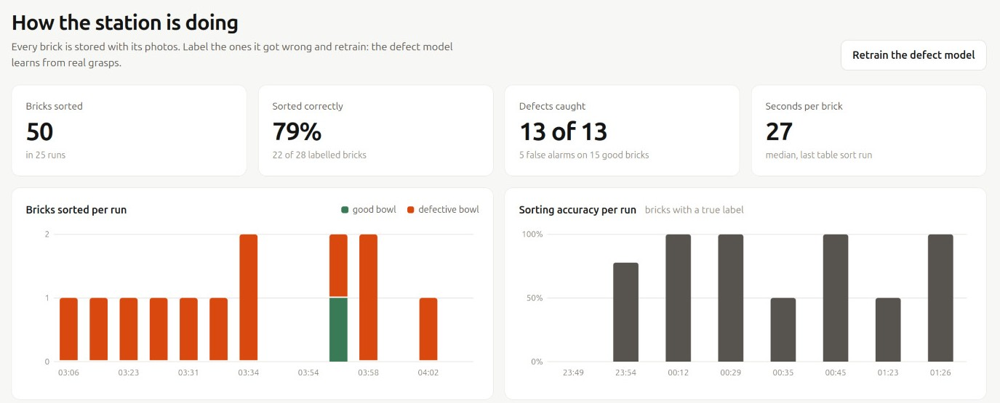
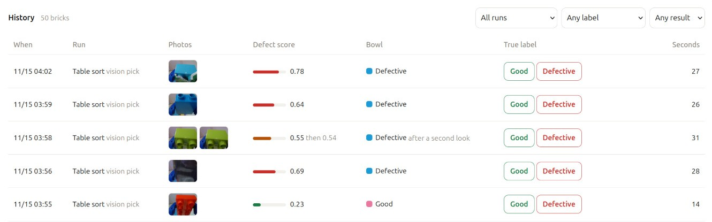

# SecondLook

**A low-cost SO-101 arm that finds bricks on a table, holds each one up to the camera on its own gripper,
spots defects it was never shown, and sorts them into a good bowl and a reject bowl. Every decision runs on
one Intel Core Ultra laptop.**

Built at Junction 2026 for the **Ignite Next × Intel Physical AI Challenge**.

**[▶ Watch the 2-minute video](https://youtu.be/S4IuWnl2aAo?is=rWpl7n40N_tJgDss)** ·
**[Trained models (release)](https://github.com/ayush-techx/junction-2026/releases/tag/models-v1)** ·
**[Station setup guide](docs/SETUP.md)**

| 🎯 Defects caught | ✅ Sorted correctly | ⚡ Inspection on Intel iGPU | 🦾 Teleoperated demos | 🧠 Models trained |
|:---:|:---:|:---:|:---:|:---:|
| **10 / 10** | **19 / 21** | **17 ms** | **198** | **5**, all on OpenVINO |

<p>
  
  
  
</p>

*Left: the top camera finds the brick and both bowls. Right: the wrist camera's view of a held brick. The
anomaly model lights up a marked brick (score 0.83, rejected) and stays dark on a clean one (0.00).*



*The control center's Station view: one button sorts the whole table. The top camera marks each brick and both
bowls; the last brick's wrist photo, verdict and defect score sit on the right.*

## Why

Duplo bricks are made for toddlers, so a damaged one should never reach a child. On many lines a person still
checks parts by eye for hours, and attention drops over a shift. Automating that usually means a specialist
programming a robot cell for each product. SecondLook is taught by demonstration and by example photos
instead: show it the job, show it what "good" looks like, and it flags anything else.

## What it does

1. **Find.** The top RealSense camera fits the table plane from depth and finds every brick-sized object
   (6–60 mm tall). The bowls are found by colour, and the arm and box are ignored.
2. **Pick.** Choose the pick engine in the control center:
   - **Learned pick:** ACT or SmolVLA policies trained in Intel Physical AI Studio from 198 teleoperated
     demos. SmolVLA takes a plain-language instruction ("…place it in the pink bowl").
   - **Vision pick:** the brick position goes through a hand-eye transform and inverse kinematics on the
     SO-101 URDF, with the wrist turned so the fingers close across the brick.
3. **Check the grasp.** The gripper squeezes and reads its position, so an empty grasp is caught at once and
   checked again at the inspection pose.
4. **Inspect.** The wrist camera sees the held brick close up, always in the same place. A PatchCore model
   (Anomalib → OpenVINO FP16 → Intel iGPU) trained only on clean bricks scores it and draws a heatmap.
5. **Second look.** If the score is unsure, the arm puts the brick down, grasps it again and re-inspects it
   from a new angle. A clean second view clears it; any defective view rejects it. Unsure twice goes to the
   reject bowl for a person to check, so nothing uncertain ships.
6. **Sort and tell.** The brick goes to the pink (good) or blue (reject) bowl. Every result is spoken
   ("Good brick. Pink bowl. Two left.") and shown in large text. **Sort the table** repeats until the table
   is clear.
7. **Keep learning.** In the History view, mark any inspection photo as good or defective.
   `./sl recalibrate` (or `--learn-every 5` during a run) retrains in the background and hot-swaps the model
   without stopping the station.

## Results

Measured on our station. Raw logs are in [`docs/results/`](docs/results/), and the tables regenerate with
`./sl results`.

**Inspection and sorting** (21 bricks with recorded ground truth, real defects and clean bricks):

| Metric | Result |
|---|---|
| Sorted into the right bowl | **19 / 21 (90%)** |
| Defects caught | **10 / 10 (100%)** |
| Final calibrated run (`calib2`) | **4 / 4 correct, 0 false alarms** |
| Held-out photos, current model | **4 / 4 good passed, 4 / 4 defects rejected** |
| Median cycle time (inspect + sort) | 16.4 s |

**On-device inference** (OpenVINO on an Intel Core Ultra X9):

| Model | Device | Precision | Latency |
|---|---|---|---|
| PatchCore (defects) | iGPU | FP16 | **16.6 ms** median in the live pipeline (77 images) |
| PatchCore (defects) | iGPU vs CPU | FP16 | **30 ms vs 224 ms** p50 in `./sl bench` (**~7× faster on the iGPU**) |
| ACT (pick policy) | iGPU | FP32 | **~9 ms** per step |
| SmolVLA (vision-language-action) | iGPU | FP32 | **~106 ms** per step |

**Pick engines compared** (all logged attempts):

| Pick engine | Picked / attempts | Median cycle |
|---|---|---|
| Vision pick (depth + IK) | 17 / 49 | 25.9 s |
| ACT 20 epochs (learned) | 6 / 20 | 26.0 s |

## Models we trained and compared

We trained and compared several models for each job, and kept the best one as the default. All of them are
exported to OpenVINO and attached to the [`models-v1` release](https://github.com/ayush-techx/junction-2026/releases/tag/models-v1).

**Pick policies** (Intel Physical AI Studio, trained on Modal GPUs from 198 teleoperated demos, each labelled
"pick up the brick and place it in the {pink | blue} bowl"):

| Model | What we learned | Status |
|---|---|---|
| ACT, 6 epochs | First baseline: too short to pick reliably | Replaced |
| ACT, 20 epochs | Picks bricks; 9 ms per step on the iGPU | In release (`--all`) |
| **ACT v3**, 12 epochs | Cleaned demos + data augmentation | **Default learned policy** |
| **SmolVLA**, 20k steps | Language-conditioned: chose the bowl named in the instruction in **10 / 10** offline tests | In release (`--all`) |
| Vision pick (no training) | Depth + inverse kinematics, our analytical baseline | Default for "Sort the table" |

**Defect models** (Anomalib PatchCore, trained only on clean bricks, OpenVINO FP16 on the iGPU):

| Model | Trained on | Role |
|---|---|---|
| **PatchCore** | Clean hand-fed bricks | **Decides the bowl.** Threshold 0.486, unsure band ±0.08 triggers the second look |
| **PatchCore-live** | Also bricks grasped by the robot itself | Consulted on unsure scores, tuned separately |
| Gemini Flash (cloud, optional) | Pretrained vision-language model | **Names** the defect for the voice; never decides (see below) |

Why two PatchCore models: a brick held by the robot sits slightly differently from a hand-fed one. A second
model trained on the robot's own grasps settles exactly those borderline cases, and after calibration the
final run had zero false alarms.

**Total policy training cost: about $15 of Modal GPU time** (A10G).

## Built on the Intel stack

| Step | Intel tool | Where it runs |
|---|---|---|
| Teleoperated recording, dataset labelling | **Intel Physical AI Studio** (`junction2026` branch) | Laptop |
| Policy training (ACT, SmolVLA) | Physical AI Studio → Modal GPU training targets | Cloud GPU (training only) |
| Policy export + inference | **OpenVINO** via `physicalai.inference.InferenceModel` | **Intel iGPU** |
| Defect model training | **Anomalib** (PatchCore) | Laptop |
| Defect model inference | **OpenVINO FP16** | **Intel iGPU** |
| Orchestration, voice, dashboard, power telemetry (RAPL) | Python | CPU |

We benchmarked every model on CPU and iGPU and run each one where it is fastest. All run-time inference stays
on the laptop.

## Where the cloud is used, and why

The **decision path** (find, pick, inspect, choose the bowl) runs **100% on the laptop**. Two optional
helpers from our `accessinspect/` module use online services, only to make results easier to understand:

| Helper | Service | What it does | What is sent | Offline behaviour |
|---|---|---|---|---|
| Defect naming | Google **Gemini Flash** | Names the defect (tape, sticker, marker) and the brick colour for the voice and the log | The brick crop | Answers are cached by image, so known photos work offline |
| Ava voice | Microsoft neural voice (edge-tts) | Speaks results in a natural voice | The sentence text | Phrases are cached; **Piper** (fully offline neural voice) takes over automatically |

**Why Gemini only names and never decides:** on 29 real grasp photos, Gemini cleared 5 of 6 borderline
PatchCore alarms but missed 5 of 13 real defects. PatchCore caught all 10 defects in our sort test. So the
local model decides, and the large model explains.

For a fully offline station, set `accessinspect.gemini: false` in `secondlook/config.yaml` and choose the
Piper voice.

## Control center

A local web app (http://127.0.0.1:8770, runs as a systemd user service):

- **Station:** one **Sort the table** button; the table as camera, height map or pick map; bowl counts; the
  last brick's wrist photo, verdict and score; live inference times on this laptop.
- **Insights:** bricks sorted, accuracy and defects caught across every run; the defect score of every
  labelled brick against the cut-off; a full **History** where one click labels any photo; and a
  **Retrain the defect model** button that retrains and hot-swaps it.
- **Models:** switch the pick engine (Vision / ACT 20ep / ACT v3 / SmolVLA) and the defect model, retrain,
  or roll back to an earlier model.
- **Stage view:** a clean full-screen view for demos, and a voice toggle.



*Models: pick how the arm grasps (geometry, two ACT policies, or the SmolVLA vision-language-action model),
see the defect model running on the Intel GPU with OpenVINO FP16, retrain it from labelled photos, or roll
back to an earlier one.*



*Insights: every brick ever inspected, across all 25 runs including the early ones before calibration.
**13 of 13 labelled defects caught.***



*History: every brick with its wrist photos and score. The 03:58 brick shows the second look in action
(two photos, 0.55 then 0.54). One click on Good or Defective turns any photo into training data.*

## Accessible by design

Every result reaches the operator on two channels: large high-contrast text with screen-reader announcements,
and a spoken voice. One key, a touch button or a USB foot pedal starts each inspection, so nobody needs to
speak or use a mouse. Next, we want to test it with the people it is designed for.

## How it is built

```
Physical AI Studio:  teleop demos (198) ─► ACT / SmolVLA training ─► OpenVINO export ──────────┐
Anomalib:            clean-brick photos ─► PatchCore ─► OpenVINO FP16 ──────────────────────┐  │
                                                                                            ▼  ▼
SecondLook:  scene (depth + colour) ─► picker (IK or policy) ─► grasp check ─► inspector (iGPU)
             ─► decide (good / unsure → second look / defective) ─► bowl ─► voice + dashboard + SQLite history
Control center (systemd, :8770): station view · sort the table · insights · model switcher · stage view
```

| Path | Purpose |
|---|---|
| `secondlook/cell.py` | the app: `check`, `teach`, `collect`, `run`, `review`, `scene`, `table` |
| `secondlook/machine.py` | one inspection cycle as plain, unit-tested logic |
| `secondlook/robot.py` | SO-101 and cameras through LeRobot, taught poses, grasp check |
| `secondlook/scene.py`, `table.py` | depth table plane, brick and bowl detection |
| `secondlook/kinematics.py`, `handeye.py`, `precise.py` | URDF forward/inverse kinematics, camera→robot transform, self-calibration |
| `secondlook/policy.py` | learned pick with `physicalai.inference.InferenceModel` |
| `secondlook/inspection.py`, `decide.py`, `calibrate.py` | PatchCore scoring, verdicts, threshold and unsure band |
| `secondlook/center.py`, `static/center.html` | control center (runs, live view, insights, models) |
| `secondlook/web.py`, `static/index.html`, `hud.py` | live run dashboard |
| `secondlook/announce.py` | voice: Piper (offline), espeak-ng fallback, optional Ava |
| `secondlook/history.py`, `eval_log.py` | SQLite history and CSV run logs |
| `accessinspect/` | optional helpers: Ava voice cache and Gemini defect naming |
| `tools/` | dataset prep, training, evaluation, benchmarks, recalibration, `fetch_models.sh` |
| `deploy/` | systemd unit for the control center, passive station monitor |
| `data/bricks`, `data/bricks_live` | labelled brick photos (hand-fed, and real robot grasps) |
| `tests/` | 70 tests; hardware is replaced by stand-ins |

## Data

- **198 teleoperated demonstrations**, recorded in Physical AI Studio with a leader arm, each labelled with a
  language instruction.
- **86 labelled brick photos** in this repo: 42 good and 15 defective hand-fed bricks
  ([`data/bricks`](data/bricks)), plus 16 good and 13 defective bricks grasped by the robot itself
  ([`data/bricks_live`](data/bricks_live)).
- Every run is logged to CSV and SQLite. A curated snapshot is in [`docs/results/`](docs/results/).

## Run it

The full station guide is in [docs/SETUP.md](docs/SETUP.md). It assumes Physical AI Studio is installed in
`~/physical-ai-studio`.

```bash
git clone https://github.com/ayush-techx/junction-2026.git secondlook && cd secondlook
./setup.sh                 # libraries, anomalib-env, Piper voice, models, self-test
./sl check                 # robot, cameras, models; saves a snapshot per camera
./sl teach                 # teach home, inspect and bowl poses by hand
./sl scene                 # camera-only check: bricks, bowls, height map
./sl run --scan --auto --until-clear     # sort the whole table
./sl run --handfed         # or hand bricks to the gripper
```

Models download automatically in `./setup.sh` (or run `./tools/fetch_models.sh`, add `--all` for ACT 20ep and
SmolVLA). No GitHub login is needed.

The control center runs as a user service: `cp deploy/secondlook-center.service ~/.config/systemd/user/ &&
systemctl --user enable --now secondlook-center`. It is then at http://127.0.0.1:8770.

**Public dashboard:** a read-only copy of the control center for visitors, live while the station is on and
showing the last data when it is off. Setup: [docs/PUBLIC_DASHBOARD.md](docs/PUBLIC_DASHBOARD.md).

**Hardware:** SO-101 follower arm (7.4 V servos, so use the **5 V** supply), two RealSense D4xx cameras (top
and side), a USB wrist camera, and an Intel Core Ultra laptop. Only one program may hold the arm and cameras
at a time (Studio *or* SecondLook).

## Engineering highlights

- **Got GPU training running on a brand-new Intel GPU.** Training in Studio stalled at step 0. We traced it
  through `dmesg` to the fused attention kernel at ACT's sequence length (902 tokens × batch 8), built a
  minimal repro, and switched to the math attention backend (`sdpa_kernel(SDPBackend.MATH)`).
- **Replaced a learned pixel→joint map with real geometry.** Depth plus forward/inverse kinematics on the
  SO-101 URDF and one rigid transform fits the taught points to 7–15 mm.
- **Found that borderline scores came from the robot's own grasp, not the model,** and fixed it with a full-
  squeeze grasp check and a second PatchCore model trained on robot-grasped photos: zero false alarms in the
  final calibrated run.
- **Kept learning and judging independent.** The learned policy hands over right after the grasp; inspection
  and sorting are done by the app, so each part can be improved and measured on its own.

A day-by-day log of decisions is in [docs/ENGINEERING_LOG.md](docs/ENGINEERING_LOG.md). The pitch scripts are
in [docs/pitch.md](docs/pitch.md).

## What's next

- **Self-calibration on the real arm:** `./sl table --auto` lets the arm calibrate itself with one brick and
  reaches 1–3 mm in simulation.
- **More products:** the same cell learns a new part from a few dozen demos and a folder of good photos.
- **User testing** with operators who are blind, deaf or hard of hearing, or who don't use speech.

## Team

| Name | Role |
|---|---|
| Kashish Charaya | Team lead |
| Ayush Kumar | |
| Madhuri Gade | |
| Sofia Ivanova | |

## License

MIT
