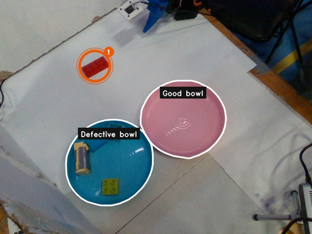
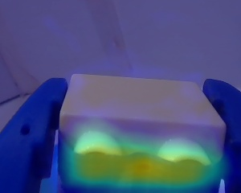
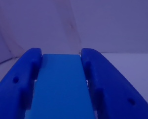

# SecondLook

**A low-cost SO-101 arm that finds bricks on a table, holds each one up to the camera on its own gripper,
spots defects it was never shown, and sorts them into a good bowl and a reject bowl. Everything runs on one
Intel Core Ultra laptop.**

Built at Junction 2026 for the Ignite Next × Intel Physical AI Challenge.

<p>
  
  
  
</p>

*Left: the top camera finds the brick and both bowls. Right: the wrist camera's view of a held brick. The
anomaly model lights up a marked brick (score 0.83, rejected) and stays dark on a clean one (0.00).*

## Why

Duplo bricks are made for toddlers, so a damaged one is a safety problem. On many lines a person still checks
parts by eye for hours, and attention drops over a shift. Automating that usually means a specialist
programming a robot cell for each product. SecondLook is taught by demonstration and by example photos instead.

## What it does

1. **Find.** The top RealSense camera fits the table plane from depth and finds every object 6–60 mm tall and
   brick-sized. The bowls are found by colour. The arm and box are flagged as "not a brick".
2. **Pick.** You can choose the pick engine in the control center:
   - **Vision pick:** the brick position goes through a hand-eye transform into the robot frame, then through
     inverse kinematics on the SO-101 URDF. The wrist is turned so the fingers close across the brick.
   - **Learned pick:** ACT or SmolVLA policies trained in Intel Physical AI Studio from 198 teleoperated demos.
3. **Check the grasp.** The gripper squeezes fully and reads its position, so an empty gripper is caught. It
   checks again at the inspection pose, and if the brick slipped it retries.
4. **Inspect.** The wrist camera sees the held brick close up, always in the same place. A PatchCore model
   (Anomalib, OpenVINO FP16, iGPU) trained on clean bricks scores it and draws a heatmap. The result is good,
   defective or unsure.
5. **Second look.** If the score is unsure, the arm puts the brick down, grasps it again and re-inspects. A
   clean second view can clear a brick, and any defective view rejects it. Unsure twice goes to the reject
   bowl for a person to check.
6. **Sort and tell.** The brick goes to the pink (good) or blue (reject) bowl. Every result is spoken aloud
   ("Good brick. Pink bowl. Two left.") and shown in large text. **Sort the table** repeats this until the
   table is clear.
7. **Keep learning.** In the history view you can mark any inspection photo as good or defective.
   `./sl recalibrate` (or `--learn-every 5` during a run) retrains in the background and hot-swaps the model.

**Accessible by design.** Every result reaches the operator on two channels: large high-contrast text with
screen-reader announcements, and an offline neural voice (Piper). One key or a USB foot pedal starts each
inspection. It has not been tested with users yet.

## Results

All numbers below were measured on our station. Raw logs are in [`docs/results/`](docs/results/), and the
table regenerates with `./sl results`.

**Inspection and sorting**, on 21 bricks where we wrote down what each brick really was (hand-fed, real
defects and clean bricks):

| | |
|---|---|
| Sorted into the right bowl | **19 / 21 (90%)** |
| Defects caught | **10 / 10** |
| Good bricks wrongly rejected | 2 / 11 |
| Median cycle time (inspect + sort) | 16.4 s |
| Last calibrated run (`calib2`) | 4 / 4 correct, 0 false alarms |
| Held-out photos, current model | 4 / 4 good passed, 4 / 4 defects rejected |

**Picking from the table** (all logged attempts, including early calibration runs):

| Pick engine | Picked / attempts | Median cycle |
|---|---|---|
| Vision pick (depth + IK) | 17 / 49 (35%) | 25.9 s |
| ACT 20 epochs (learned) | 6 / 20 (30%) | 26.0 s |

Picking is the weak link. Most misses come from a scene that kept changing (bowls, side camera and clutter
moved between calibration and runs) and from the hand-eye calibration being fitted on only 5 hand-taught
points. `./sl table --auto`, where the arm calibrates itself with one brick, cuts the error from 24 mm to
1–3 mm in simulation. It has not been run on the real arm yet.

**On-device inference** (OpenVINO, Core Ultra X9):

| Model | Device | Precision | Latency |
|---|---|---|---|
| PatchCore (defects) | iGPU | FP16 | 16.6 ms median in the pipeline (77 images); 30 ms p50 in `./sl bench` |
| PatchCore (defects) | CPU | FP16 | 224 ms p50 |
| ACT (pick policy) | iGPU | FP32 | ~9 ms per step |
| SmolVLA (pick policy) | iGPU | FP32 | ~106 ms per step |

The `./sl bench` run had the control center running at the same time. The NPU is listed by OpenVINO, but
model compilation fails with this laptop's driver (`ZE_RESULT_ERROR_UNKNOWN`), so everything runs on the iGPU.

## How it is built

```
Physical AI Studio:  teleop demos (198) ─► ACT / SmolVLA training ─► OpenVINO export ──────────┐
Anomalib:            clean-brick photos ─► PatchCore ─► OpenVINO FP16 ──────────────────────┐  │
                                                                                            ▼  ▼
SecondLook:  scene (depth + colour) ─► picker (IK or policy) ─► grasp check ─► inspector (iGPU)
             ─► decide (good / unsure → second look / defective) ─► bowl ─► voice + dashboard + SQLite history
Control center (systemd, :8770): station view · sort the table · insights · model switcher · stage view
```

| Path | Purpose |
|---|---|
| `secondlook/cell.py` | the app: `check`, `teach`, `collect`, `run`, `review`, `scene`, `table` |
| `secondlook/machine.py` | one inspection cycle as plain, unit-tested logic |
| `secondlook/robot.py` | SO-101 and cameras through LeRobot, taught poses, grasp check |
| `secondlook/scene.py`, `table.py` | depth table plane, brick and bowl detection |
| `secondlook/kinematics.py`, `handeye.py`, `precise.py` | URDF forward/inverse kinematics, camera→robot transform, self-calibration |
| `secondlook/policy.py` | learned pick with `physicalai.inference.InferenceModel` |
| `secondlook/inspection.py`, `decide.py`, `calibrate.py` | PatchCore scoring, verdicts, threshold and unsure band |
| `secondlook/center.py`, `static/center.html` | control center (runs, live view, insights, models) |
| `secondlook/web.py`, `static/index.html`, `hud.py` | live run dashboard |
| `secondlook/announce.py` | voice: Piper (offline), espeak-ng fallback, optional Ava |
| `secondlook/history.py`, `eval_log.py` | SQLite history and CSV run logs |
| `accessinspect/` | optional teammate module: Ava voice cache and a Gemini second opinion |
| `tools/` | dataset prep, training, evaluation, benchmarks, recalibration, `fetch_models.sh` |
| `deploy/` | systemd unit for the control center, passive station monitor |
| `data/bricks`, `data/bricks_live` | labelled brick photos (hand-fed, and real robot grasps) |
| `tests/` | 70 tests; hardware is replaced by stand-ins |

## Models

The weights are too large for git, so they are attached to the
[`models-v1` release](https://github.com/ayush-techx/junction-2026/releases/tag/models-v1).
`./tools/fetch_models.sh` downloads them, checks the checksums and unpacks them where `config.yaml` expects them.

| Asset | What | Used by |
|---|---|---|
| `patchcore-fp16-openvino` | defect model, trained on clean hand-fed bricks | `inspection.model` |
| `patchcore-live-fp16-openvino` | defect model, also trained on robot-grasped photos; consulted on unsure scores | `inspection.secondary_model` |
| `act-v3-openvino` | ACT, 12 epochs, cleaned demos + augmentation | `policy.path` (default) |
| `act-20ep-openvino` | ACT, 20 epochs | `--all` |
| `smolvla-20k-openvino` | SmolVLA, 20k steps, follows "pink / blue bowl" text | `--all` |

## Run it

The full station guide is in [docs/SETUP.md](docs/SETUP.md). It assumes Physical AI Studio is installed in
`~/physical-ai-studio`.

```bash
gh repo clone ayush-techx/junction-2026 secondlook && cd secondlook
./setup.sh                 # libraries, anomalib-env, Piper voice, models, self-test
./sl check                 # robot, cameras, models; saves a snapshot per camera
./sl teach                 # teach home, inspect and bowl poses by hand
./sl scene                 # camera-only check: bricks, bowls, height map
./sl run --scan --auto --until-clear     # sort the whole table
./sl run --handfed         # or hand bricks to the gripper
```

The control center runs as a user service: `cp deploy/secondlook-center.service ~/.config/systemd/user/ &&
systemctl --user enable --now secondlook-center`. It is then at http://127.0.0.1:8770.

**Hardware:** SO-101 follower arm (7.4 V servos, so use the **5 V** supply), two RealSense D4xx cameras (top
and side), a USB wrist camera, and an Intel Core Ultra laptop. Only one program may hold the arm and cameras
at a time (Studio *or* SecondLook).

## Privacy

Every model runs on the laptop. The optional Gemini second opinion (`accessinspect.gemini` in `config.yaml`)
sends the brick crop to Google, and only to name the defect for the voice. It never decides the bowl. Turn it
off for a fully offline station.

## Engineering notes

- **GPU training froze at step 0** in Studio. `dmesg` showed GPU page faults and a compute-engine reset. A
  minimal repro isolated it to the fused attention kernel at ACT's sequence length (902 tokens × batch 8); the
  math backend works (`sdpa_kernel(SDPBackend.MATH)`). Other setup fixes: FFmpeg for torchcodec,
  `libze-intel-gpu1` for Level Zero.
- **The pixel→joints map didn't generalise.** Leave-one-out error was 60–160 units on the elbow. We replaced it
  with depth plus kinematics. Forward kinematics plus one rigid transform fits the taught points to 7–15 mm.
- **False alarms came from the robot, not the model.** All the false alarms on real photos were ACT-grasped
  good bricks (scores 0.56–0.76), and some were empty grippers. A full-squeeze grasp check, a second model
  trained on robot-grasped photos, and label correction removed them in the last calibrated run.
- **The learned policies stop after one place,** because every demo ends above a bowl. So the app ends the
  policy right after the grasp and does inspection and sorting itself, which keeps the learned pick and the
  defect decision independent.

A day-by-day log of decisions and open problems is in [docs/ENGINEERING_LOG.md](docs/ENGINEERING_LOG.md).
The pitch scripts are in [docs/pitch.md](docs/pitch.md).

## Team

| Name | Email |
|---|---|
| Kashish Charaya (team lead) | kashishcharaya00@gmail.com |
| Ayush Kumar | ayushhh134@gmail.com |
| Madhuri Gade | madhurigade000@gmail.com |
| Sofia Ivanova | iv.safya@gmail.com |

## License

MIT
